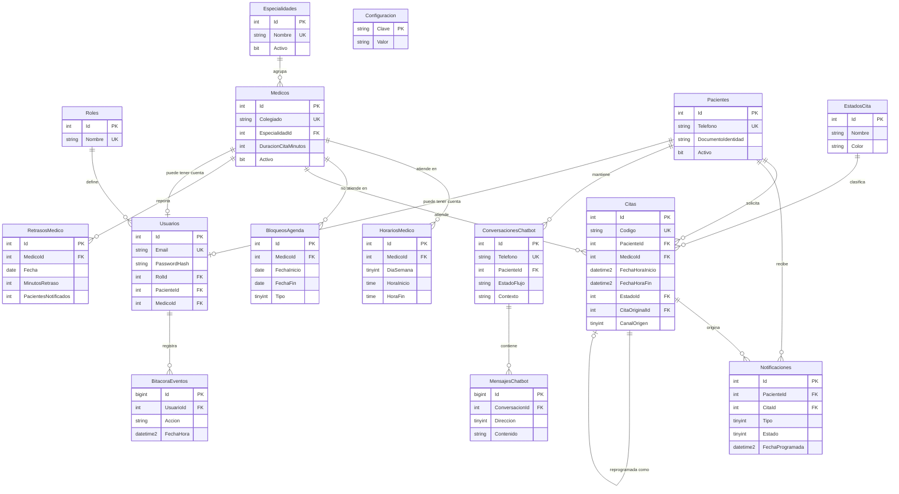

# Arquitectura y modelo de datos

## 1. Estilo arquitectónico

El sistema sigue una arquitectura **cliente-servidor en capas**, con separación estricta entre presentación, lógica de negocio y persistencia. No se emplearon microservicios, mensajería asíncrona ni patrones como CQRS: para un sistema de una sola clínica, con un volumen de citas moderado, esas piezas agregarían complejidad sin aportar beneficio medible.

```
┌──────────────────────────────────────────────────────────┐
│  Presentación                                            │
│  HTML5 · CSS3 · Bootstrap 5 · JavaScript Vanilla         │
│  Panel administrativo · Portal del paciente              │
└────────────────────────┬─────────────────────────────────┘
                         │ HTTPS / JSON (Fetch API)
┌────────────────────────▼─────────────────────────────────┐
│  Controladores (ASP.NET Core Web API)                    │
│  Autorización por rol · validación de entrada · rutas    │
├──────────────────────────────────────────────────────────┤
│  Servicios                                               │
│  Reglas de negocio · cálculo de disponibilidad ·         │
│  flujo del chatbot · notificaciones                      │
├──────────────────────────────────────────────────────────┤
│  Repositorios                                            │
│  Acceso a datos con Entity Framework Core                │
└────────────────────────┬─────────────────────────────────┘
                         │
┌────────────────────────▼─────────────────────────────────┐
│  SQL Server — 15 tablas                                  │
└──────────────────────────────────────────────────────────┘
```

Paralelo al flujo HTTP corre un **servicio en segundo plano** (`RecordatoriosWorker`) que despacha las notificaciones programadas. Es lo que hace que los recordatorios sean automáticos y no dependan de que alguien tenga el panel abierto.

### Regla de dependencia

Cada capa conoce solo a la inmediatamente inferior. Un controlador nunca consulta la base de datos directamente y un servicio nunca devuelve entidades de dominio hacia afuera: siempre convierte a DTO. Esto permite cambiar el motor de base de datos o la interfaz sin tocar las reglas de negocio.

---

## 2. Patrones aplicados

| Patrón | Dónde | Por qué |
|---|---|---|
| Repository | `Data/Repositories` | Aísla EF Core del resto del código y facilita las pruebas |
| Service Layer | `Services/Implementations` | Concentra las reglas de negocio en un solo lugar |
| DTO | `DTOs/` | Evita exponer el modelo interno y controla qué viaja por la red |
| Dependency Injection | `Program.cs` | Nativo de ASP.NET Core; desacopla las implementaciones |
| Options Pattern | `JwtSettings`, `ChatbotSettings` | Configuración tipada en lugar de cadenas mágicas |
| Middleware | `ManejadorErroresMiddleware` | Traduce excepciones a códigos HTTP en un único punto |
| State Machine | `ChatbotService` | Modela el flujo conversacional sin recurrir a IA |

---

## 3. Modelo de datos

### 3.1 Diagrama entidad-relación



### 3.2 Decisiones de diseño que conviene poder defender

**El teléfono es la llave natural del paciente.** `Pacientes.Telefono` tiene restricción UNIQUE. El chatbot no puede pedir un usuario y contraseña por WhatsApp, así que el número identifica a la persona. Todo el flujo conversacional depende de esa unicidad.

**Los cupos disponibles no se almacenan.** No existe una tabla de "horarios libres". La disponibilidad se calcula en tiempo real: se toma el horario laboral del médico, se divide en bloques según su duración de consulta, y se descartan los bloques ya ocupados por citas vigentes o cubiertos por un bloqueo de agenda. La ventaja es que al cancelar una cita el horario vuelve a estar libre de forma automática, sin ninguna lógica adicional que pueda quedar desincronizada.

**La doble reserva se impide en el motor, no en el código.** Existe un índice único filtrado:

```sql
CREATE UNIQUE INDEX UX_Citas_NoDobleReserva
    ON Citas (MedicoId, FechaHoraInicio)
    WHERE EstadoId IN (1, 2, 3);
```

El servicio también valida antes de insertar, pero si dos solicitudes llegan al mismo milisegundo (por ejemplo, una desde el panel y otra desde WhatsApp), la restricción de la base de datos es la que garantiza que solo una prospere. Validar únicamente en la aplicación dejaría una ventana de concurrencia abierta.

El filtro `WHERE EstadoId IN (1,2,3)` es lo que permite que un horario cancelado o completado pueda volver a usarse.

**Reprogramar no modifica la cita original.** La cita anterior pasa al estado *Reprogramada* y se crea una nueva que apunta a ella mediante `CitaOriginalId`. Así queda un rastro completo de cuántas veces se movió una cita, dato que alimenta los reportes de la tesis.

**Los bloqueos con `MedicoId` nulo aplican a toda la clínica.** Un feriado nacional se registra una sola vez en lugar de repetirse por cada médico.

**`DiaSemana` usa TINYINT de 0 a 6**, compatible con `System.DayOfWeek` de .NET. Evita conversiones y errores de desfase entre la base y el código.

---

## 4. Seguridad

### Contraseñas

Se usa **PBKDF2 con SHA-256**, 100.000 iteraciones, salt aleatorio de 16 bytes y hash de 32 bytes. El formato almacenado es `iteraciones.salt.hash`, todo en Base64. Se eligió PBKDF2 porque viene incluido en .NET y no obliga a agregar dependencias externas al proyecto.

La comparación de hashes usa `CryptographicOperations.FixedTimeEquals`, que tarda lo mismo sin importar en qué byte falle la comparación. Esto cierra un canal lateral de temporización.

### Autenticación y autorización

JWT firmado con HMAC-SHA256. El token incluye el identificador del usuario, su rol y, cuando corresponde, el `PacienteId` o `MedicoId` asociado. Los controladores se protegen con `[Authorize(Roles = ...)]`.

Los tres roles del sistema:

| Rol | Alcance |
|---|---|
| Administrador | Acceso total, incluida la gestión de usuarios y parámetros |
| Recepcionista | Operación diaria: citas, pacientes, médicos, horarios, chatbot y reportes |
| Médico | Solo sus propias citas, sus propios pacientes y reporte de retrasos |
| Paciente | Interno del chatbot; no accede al panel administrativo |

Un paciente que intente consultar `/api/pacientes/5/citas` sin ser el paciente 5 recibe 403. La validación se hace comparando el `PacienteId` del token contra el recurso solicitado.

### Mensajes de error en el inicio de sesión

Un correo inexistente y una contraseña incorrecta producen exactamente la misma respuesta: *Correo o contraseña incorrectos*. Diferenciarlos permitiría enumerar qué cuentas existen en el sistema.

### Protección de la cuenta raíz

La cuenta `admin@medicitas.com` no puede desactivarse desde la interfaz. Evita el escenario de quedarse sin ningún administrador activo.

---

## 5. Flujo del aviso de retraso

Es el requisito más específico del documento del cliente y merece describirse paso a paso:

1. La recepcionista abre *Citas* y reporta que la doctora lleva N minutos de retraso.
2. `RetrasoService` recupera todas las citas vigentes de ese médico, ese día, cuya hora aún no ha pasado.
3. Registra el retraso en `RetrasosMedico` con el conteo de pacientes afectados.
4. Genera una `Notificacion` de tipo *Retraso* por cada paciente en cola, indicando el atraso y ofreciendo dos opciones.
5. Coloca la conversación de WhatsApp de cada paciente en el estado `RETRASO_DECISION`, guardando el identificador de su cita en el contexto.
6. Si el paciente responde **1**, se mantiene su cita. Si responde **2**, el chatbot le ofrece los cupos libres más próximos y reprograma.

Un detalle importante: la reprogramación motivada por un retraso del médico **omite la restricción de anticipación mínima**. Normalmente una cita no puede moverse con menos de cuatro horas de antelación, pero sería injusto aplicar esa regla cuando el retraso lo causó la clínica. El parámetro `omitirAnticipacion` de `ICitaService.ReprogramarAsync` existe exactamente para eso.

---

## 6. Flujo del chatbot

`ChatbotService` implementa una máquina de estados finita. No hay modelo de lenguaje ni procesamiento semántico: el bot interpreta números de opción y palabras clave, tal como delimita el marco teórico de la tesis.

```
MENU_PRINCIPAL
 ├─ 1 → AGENDAR_ESPECIALIDAD → AGENDAR_MEDICO → AGENDAR_FECHA → AGENDAR_HORA → AGENDAR_CONFIRMAR
 ├─ 2 → (muestra próximas citas) → MENU_PRINCIPAL
 ├─ 3 → SELECCION_CITA_CONFIRMAR
 ├─ 4 → SELECCION_CITA_REPROGRAMAR → AGENDAR_FECHA → AGENDAR_HORA
 └─ 5 → SELECCION_CITA_CANCELAR

Estados auxiliares:
 REGISTRO_NOMBRE → REGISTRO_APELLIDO   (solo si el teléfono no está registrado)
 RETRASO_DECISION                       (activado por el panel al reportar un retraso)
```

El estado y el contexto de cada conversación se guardan en `ConversacionesChatbot`. El contexto es un JSON pequeño con las selecciones parciales del usuario (especialidad elegida, médico elegido, fecha elegida). Persistirlo en base de datos, y no en memoria, permite que la conversación sobreviva a un reinicio del servidor.

Las palabras *menu*, *hola*, *inicio* y *buenas* devuelven al usuario al menú principal desde cualquier punto. El texto se normaliza quitando acentos y mayúsculas antes de compararlo, para que *Menú* y *menu* sean equivalentes.

---

## 7. Parámetros configurables

Se almacenan en la tabla `Configuracion` y se editan desde el panel sin recompilar:

| Clave | Efecto |
|---|---|
| `RecordatorioHorasAntes` | Cuántas horas antes de la cita se envía el recordatorio |
| `CancelacionHorasMinimas` | Anticipación mínima para cancelar o reprogramar |
| `DiasMaximosAgendamiento` | Hasta cuántos días hacia adelante se puede agendar |
| `NombreClinica` | Encabezado de los mensajes del chatbot |
| `TelefonoClinica` | Contacto que se ofrece en los mensajes |
| `MensajeBienvenida` | Primer texto que recibe el paciente |
| `HorarioAtencionTexto` | Información mostrada al paciente |
| `MaximoCitasPorPaciente` | Límite de citas vigentes simultáneas |
